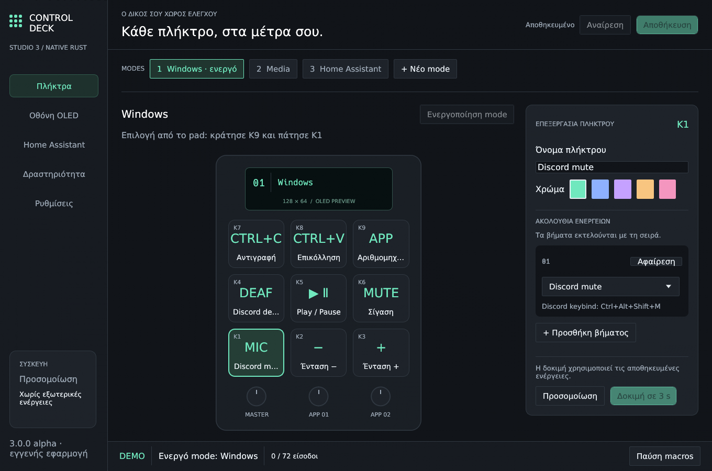

# Control Deck Studio 3 · Native Rust

A new native desktop implementation of the macropad editor. **Frontend and backend are Rust.** egui/eframe draws the native UI; in-process Rust workers handle persistence, macros, Windows input, Home Assistant and USB. There is no web server, browser, WebView, JavaScript, Python runtime or cloud dependency during normal use.

**Status: 3.0.0-alpha.1.** Core/editor implementation and automated checks are available. Actual Windows, ESP32 and Home Assistant acceptance remain pending. This is development source, not the finished installer. The previous Studio and firmware remain separate.



## Develop

Install Rust stable from https://rustup.rs/ . On Windows select the MSVC toolchain and install the Visual Studio C++ build tools when the official installer requests them.

```sh
cargo run -p deck-desktop -- --demo
cargo run -p deck-desktop
cargo test --workspace
cargo clippy --workspace --all-targets -- -D warnings
cargo fmt --all --check
cargo build --release -p deck-desktop
```

Use `--data-dir PATH` to isolate testing data. Demo mode prevents OS input, physical USB operations and HA network access. On Linux, Windows input/USB are explicitly unavailable. Ubuntu native builds may need `build-essential pkg-config libxkbcommon-dev libwayland-dev libx11-dev libxcursor-dev libxrandr-dev libxi-dev libgl1-mesa-dev`; native file dialogs need an XDG desktop portal. The target product is Windows 10/11 x64.

Run from Windows PowerShell: `./scripts/dev.ps1 -Demo` or `./scripts/check.ps1`. A release build produces `target/release/macropad-studio.exe`. Development does not automatically open a browser or flash firmware.

## Implemented

- Typed configuration, validation, 1–12 profiles, 9 keys each and 8 hardware modes.
- Strict import of legacy schema-1 profile exports and schema-3 native exports; no credential import.
- Draft versus saved editing, action sequences/reordering, save/revert, duplicate/new mode, explicit activation and delayed tests.
- Windows hotkey/text/application/URL/media/Discord adapters; 72 bank/key input registrations with conflict reporting.
- Separate controller, macro worker, background file/HA operations and a single USB owner. Bounded queues, overload errors and pause cancellation.
- Atomic configuration/artwork writes, backups and a process lock in a new v3 data directory.
- Home Assistant connection/catalog/service client, masked token input, Windows DPAPI storage, no token in profile exports.
- Native per-key monochrome drawing, PNG/JPEG import and GIFs up to 24 frames, with 14px mode-header reservation and firmware-compatible CDAN/HID transfer.
- Activity and diagnostics with explicit demo, USB, registered-input and HA states.

These bullets describe source implementation; see `TASKS.md` and `docs/VERIFICATION.md` for the acceptance evidence and remaining tasks. Windows adapters have been cross-checked by the Rust compiler, not exercised on the user's PC.

## Usage

Close the previous Studio bridge before enabling native Windows input; both register F13–F21. The pad layout is K7/K8/K9 at the top, K1/K2/K3 nearest the user. First eight saved profiles map to K9 + K1–K8. Selecting an editor mode does not activate it. Save the draft, then use Activate to change the application/device mode.

Save does not execute actions. Test uses saved actions after 3 seconds. Discord actions require the user's custom Discord keybinds Ctrl+Alt+Shift+M and Ctrl+Alt+Shift+D. The UI cannot read Discord's mute state. Windows input targets the active window and follows Windows privilege restrictions.

On the Display page, Save stores artwork on the PC. Send Kx stores the selected saved clip on the pad and requires a verified USB connection. Artwork is shared across modes, matching current firmware. Image content is fitted below the mode header. GIF timing is quantized to firmware-supported 125–2000ms increments; GIFs over 24 frames are rejected, not silently truncated. Maximum file size8MiB; still images2048×2048, GIF512×512. Legacy OLED-bank JSON importer, text/shape tools and the idle artwork slot remain pending.

Closing the window currently stops this native process and its macros. Tray/background lifecycle and startup are separate next tasks. The three knobs in the deck preview are illustrative: no potentiometer firmware/app-volume implementation is included yet.

## Data and recovery

Data is separate from `%LOCALAPPDATA%\\ApostolosControlDeck`. The exact v3 directory appears in Settings. `config.previous.json` and `artwork.previous.json` preserve the previous save. A corrupt config is never silently replaced with defaults. Close Studio, retain a copy of the corrupt file, then restore the previous file before restarting.

HA tokens are DPAPI-encrypted for the current Windows user. On Linux they are session-only. Never place tokens or real user profiles in the repository. Firmware is not rewritten by this application.

## Project navigation

- [Roadmap](ROADMAP.md) and [task checklist](TASKS.md)
- [Work log](docs/WORK_LOG.md)
- [Architecture](docs/ARCHITECTURE.md), [native ADR](docs/adr/0001-native-rust.md), [UX brief](docs/UX.md)
- [Migration](docs/MIGRATION.md), [verification](docs/VERIFICATION.md), [performance](docs/PERFORMANCE.md)
- [Windows acceptance](docs/WINDOWS_ACCEPTANCE.md)

Private repository: https://github.com/Apopal1/macropad-studio-rust . Source publication is in progress. The GitHub connector has no installed repository access and local CLI is unauthenticated, so the authenticated GitHub web interface is being used. The original local Git history is retained.

No open-source license grant is made by this baseline. Third-party font terms are included under `assets/`. Dependency licenses remain owned by their respective authors.
