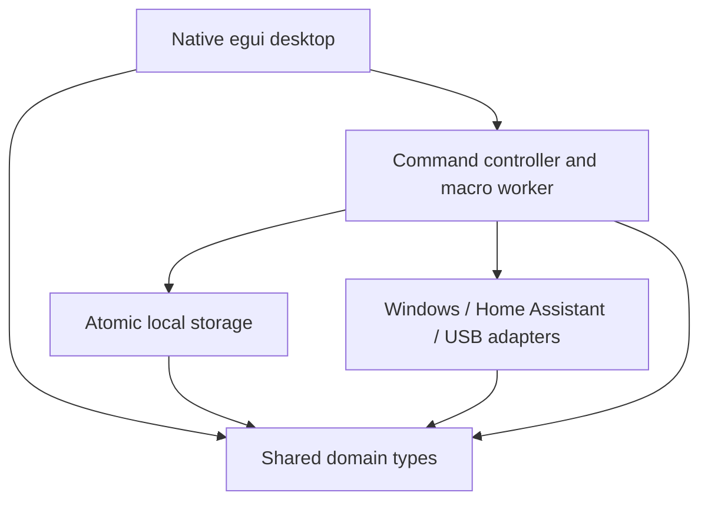

# Native architecture

## Dependency boundaries

- `deck-domain`: configuration schema, validation, legacy import, hotkey parser, bounded monochrome artwork and device protocol. No OS or GUI dependency.
- `deck-storage`: separate v3 app-data directory, single-instance file lock, atomic writes and previous-version backups. Never overwrites legacy data.
- `deck-platform`: Windows input/hotkeys, protected credentials, HA HTTP, HID feature transport. Linux provides an explicit preview environment, not pretend Windows input.
- `deck-runtime`: typed commands/events over bounded queues. Controller serializes config mutations; macro worker executes snapshots away from UI and supports pause/cancellation. Queues reject overload visibly.
- `deck-desktop`: draft editing, navigation, native dialogs and painting. Draft and saved config are distinct; no execution from unsaved drafts. Uses eframe/egui with glow, no browser runtime.

## UX state model
Editing a mode does not silently activate it. Save persists the entire validated draft; Activate chooses a saved hardware mode. The inspector follows selected key; the physical arrangement is K7–K9 / K4–K6 / K1–K3. Test is explicit and delayed; save, import, connection checks and selecting a key never execute macros. Physical input routes using the firmware-encoded bank, avoiding polling races.

Hardware connection, input registration, HA connection and application running are distinct statuses. Unsupported operations return errors. Demo mode never registers hotkeys, sends OS input, contacts HA or writes device data.

## Failure and resource model
No localhost HTTP listener. No idle 60 Hz loop: eframe repaint is driven by input/events, and timed only while feedback is active. Bounded command/action/event queues; bounded macros, image dimensions/frames and network response bodies. HA has timeouts, certificate validation, no redirects and no automatic retries of service calls. UI only receives sanitized errors and status, never credentials.

Config schema 3 keeps 1–12 profiles and 9 keys per profile. First 8 are hardware modes. Config and artwork are separate; credentials are separate from both. Application supports independently versioned config migration. Windows uses DPAPI current-user scope for persisted HA token; non-Windows credentials remain session-only. Actual OLED header always belongs to firmware; local preview reserves its top 14 rows.

## Release boundaries
This is a new alpha implementation. A Windows cross-check is not a Windows runtime test. USB protocol unit tests do not establish device compatibility. Real hardware/HA/Windows acceptance remains separately tracked.
